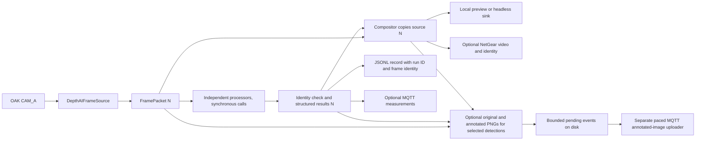

# Shared camera stream

For Aidan's model integration, start with the [computer vision handover](../README.md).
It explains the adapter contract, coordinate mapping and the GCS work still needed.

One OAK-D Lite CAM_A source feeds synchronous processors, then a compositor,
then the local preview. The original image is preserved. ArUco and Aidan's
gauge/valve detector are connected as optional branches; detected gauge crops
pass to the existing pressure reader. Optional MQTT measurements and
VidGear/NetGear video connect to a local network demonstration, with a small HTTP
bridge for browser viewing.

This implements the local integration structure in
`reports/CV_Subsystem_Integration_Conceptual_Design.md`, particularly sections
6, 11–16. That report is a historical design baseline: its statements that
ArUco and composition are unimplemented are no longer current. This README
and its linked walkthroughs describe the current implementation. For the separate
measurement and video routes, start with [the local network walkthrough](docs/local-network-walkthrough.md).

## Run

In this worktree's `Advanced Systems Design/Computer Vision/Camera Stream`:

```sh
.venv/bin/python -B run_camera_stream.py
```

The standalone command defaults to 1280×720 at a requested 30 FPS. The demo
launcher defaults to 1920×1080. Both accept `--profile 720p30` or
`--profile 1080p30` explicitly.
The preview starts at 960×540 and can be resized; this only affects the window,
not the source pixels or camera calibration. Press **q**, **Esc**, or close the
window to stop. Ctrl+C also releases the camera and records interruption.
Only one program can own the OAK at a time; stop the standalone ArUco runner
before starting this one.

For the screen marker measured at approximately **150 mm**:

```sh
.venv/bin/python -B run_camera_stream.py \
  --profile 1080p30 \
  --aruco \
  --marker-side-length-m 0.15 \
  --calibration '../ArUco Detection/calibration/oak_cam_a.json' \
  --calibration-mode oak-1080
```

For the assignment's physically measured 200 mm square, use `0.20` instead.
Generator settings are not evidence of the size shown on a monitor. The side
length refers to the outer black square, excluding the surrounding white margin.

A bounded run without opening a preview:

```sh
.venv/bin/python -B run_camera_stream.py \
  --headless --max-frames 300 --profile 720p30
```

Add the ArUco options to test processing without a window. A frame limit counts
processed packets, not every sensor exposure. `--output-dir /path/to/new-run`
selects a new evidence directory and refuses to overwrite an existing one.
Default evidence location is `diagnostics/sessions/<UTC>-<unique suffix>` relative
to the working directory. The command works from another directory when given
its full path and the correct Python interpreter; calibration paths remain
relative to your current directory.

## Target detection and gauge reading

Create a separate target environment from this folder, using the existing camera
environment's Python. The target requirements include the network dependencies:

```sh
.venv/bin/python -m venv .venv-targets
.venv-targets/bin/python -m pip install -r requirements-targets.txt
```

Start a direct camera preview with targets enabled:

```sh
.venv-targets/bin/python -B run_camera_stream.py \
  --targets --profile 720p30 --max-frames 300
```

Or use the local broker, result subscriber and browser video together:

```sh
.venv-targets/bin/python -B run_local_demo.py \
  --camera --targets --profile 720p30 --max-frames 300 --open-browser
```

`300` is an example frame limit; choose the count you need. The profile requests
30 FPS from the camera, while inference and outputs determine actual processed
FPS. The direct command can take `--headless` to omit its window. The demo uses a
headless sender and serves the annotated video in the browser.

Both commands default to `Target Detection/models/50_epoch_best.pt`, resolved
relative to the source files rather than the terminal's working directory. To
use other local weights, add `--target-model "/path/to/weights.pt"`; this requires
`--targets`. Explicit relative paths are resolved from your working directory.
Aidan's class list remains in `Target Detection/data/v2_EGH455-3/data.yaml`.
Startup rejects weights whose class names/order do not match that list.

The direct runner can combine targets with `--aruco`; the demo already enables
ArUco. Both accept every ID from 0 to 99 in `DICT_5X5_100` by default. Add
`--permitted-ids 7` only when you want to restrict accepted poses to that ID.
Add the camera calibration and measured marker-size options
shown above when metric ArUco pose is needed. They do not calibrate the gauge:
the reader currently assumes a 0–10 bar dial, so review its `GaugeCalibration`
against the real gauge. Gauge labels show an accepted pressure or
`pressure unavailable`; valves retain the model's detected class name.

The model loads once in the sender before the camera opens. Cold model startup
has taken about 25 seconds locally, so allow time after `Loading target model...`
before expecting video. With targets enabled, the demo gives its video receiver
60 seconds to receive its first or next frame. The demo still has an overall
time limit based on the requested frame count. Runs without `--targets` can keep using the existing
`.venv` and do not import the model runtime. Detection quality and target
throughput on a physical camera stream still need validation; a requested 30 FPS
is not a measured inference rate.

## Local network demonstration

```sh
.venv/bin/python -m pip install -r requirements-network.txt
.venv/bin/python -B run_local_demo.py --open-browser
```

The default generates a visibly synthetic ID 7 marker using invented calibration,
runs up to 900 processed frames, and saves evidence in a new
`diagnostics/local-network/` directory. It starts a local aMQTT broker, a JSON
subscriber, a NetGear video receiver with HTTP preview, and the headless sender.
Open `http://127.0.0.1:8080/stream.mjpeg` if you omit `--open-browser`. Ctrl+C stops
the processes. Every endpoint stays on the local machine by default.

The advertised video address ends in `/stream.mjpeg`. Existing `/stream.mjpg`
links still serve the same MJPEG stream.

MQTT sends measurements on `taip/local/results`; NetGear separately sends the
annotated JPEG and identity. Match `(run_id, sequence_number)` between routes.
The default is a software demonstration, not a camera or calibration test.
`--camera` selects the OAK; missing calibration retains detections but withholds
metric pose. See [commands, evidence and the two-terminal walkthrough](docs/local-network-walkthrough.md)
for the hardware options and transport delivery limits.

To view the attached OAK from a phone or laptop on the same LAN, bind only the
HTTP viewer to this Mac's Wi-Fi address:

```sh
.venv/bin/python -B run_local_demo.py \
  --camera --profile 1080p30 --http-host 10.88.38.220 --max-frames 18000
```

Open `http://10.88.38.220:8080/stream.mjpeg` on the other device while the command
runs. `10.88.38.220` was this Mac's address on 8 October and may change; check it with
`ipconfig getifaddr en0` (`en0` is the current Wi-Fi interface on this Mac).
MQTT and NetGear stay on loopback; `--http-host` exposes only the plain,
unauthenticated HTTP viewer on the selected concrete IPv4 interface. Use it on
a trusted LAN, without internet forwarding. See the
[LAN viewing steps and connection checks](docs/local-network-walkthrough.md#view-the-oak-from-a-phone-or-laptop)
for firewall and guest-network considerations. Viewing from another device
still needs to be checked on that device.

The report's proposed deployment broker remains Mosquitto. The local launcher
uses aMQTT after the attempted Homebrew Mosquitto install failed on a dependency.
The final team's broker, remote processing deployment and full UI still need integration.

## GCS logs and detection images

Lachlan's GCS accepts MQTT logs on `gcs/drone_log` and image events on
`gcs/detection`. The current Pi-local GCS broker is `127.0.0.1:1883`.
The publication examples below run on the Pi; a forwarder on the Mac instead
uses the Pi's current LAN address, `10.88.39.170`. The Pi's camera viewer is
`http://10.88.39.170:8080/stream.mjpeg`; bind its HTTP host to that address.
The existing HTTP video link remains independent. With the camera demo running,
preview adapted logs in a second terminal:

```sh
.venv/bin/python -B run_gcs_forwarder.py --timeout-s 30
```

To publish sampled ArUco, gauge and valve logs, explicitly select the destination:

```sh
.venv/bin/python -B run_gcs_forwarder.py \
  --publish --broker 127.0.0.1 --port 1883 \
  --interval-s 5 --timeout-s 600
```

For automatic detection images, add `--capture-detections --capture-interval-s 3`
to the camera/demo command. With `--targets`, a visible gauge or valve selects
one frame every three seconds, covering all targets in that frame. Each selection
keeps the untouched full-resolution `frame-N.png` and a full-resolution
`frame-N.annotated.png` from that frame's composed annotations, with no extra
detector pass. ArUco still uses one selection per sighting, with confirmation,
absence and cooldown checks. Then run `run_gcs_image_forwarder.py` against the
printed capture queue. Each selected frame creates one event and one annotated
photo upload; GCS retains that annotated copy while originals stay on the Pi.
Use `--interval-s 3` on the uploader too; its byte budget can extend this interval.
The default bounds remain three pending events and 256 MiB per session, with
both PNG files counted toward storage.
Use `--publish-timeout-s 60 --timeout-s 0` for a 60-second image acknowledgement
wait and continued operation until Ctrl+C. The default runtime remains 600
seconds. Startup and periodic status show the selected folder, destination and
pending work; point each new camera run's uploader at its new capture directory.
Connections that fail before publication are retried with a delay; an upload
with uncertain delivery is recorded as failed and is not replayed automatically. See
[automatic detection images](docs/gcs-integration.md#automatic-images-aruco-sightings-and-periodic-targets)
for commands and what these limits mean.

The exact outer log schema remains `{action, content}`. Existing ArUco text and
its identity footer are unchanged. Each gauge adds a `Gauge detected` message
with `Pressure: 2.9 bar` or `Pressure unavailable`; pressure awaiting three-frame
confirmation is explicitly labelled. Each valve adds `Valve detected`
with `Open valve` or `Closed valve`. Target text includes image centre and frame
number. Full source identity stays in native records and the local audit; target
logs omit the longer ArUco run/time footer. A failed target branch produces
`Target processing error`.

The forwarder selects one frame per interval (five seconds by default), then
sends all its prepared messages. One sample can therefore produce several small
logs. The terminal prints their action/content, the destination and the evidence
path. Restart the camera and both forwarders after updating these files so each
process loads the new behavior. Preview opens no GCS connection. The forwarder can run in either
`.venv` or `.venv-targets`. Each message has its own audit line. On a publication
failure, earlier acknowledgements are retained, the failed message is marked
`failed`, and remaining messages are `not_attempted`; the forwarder stops without
retrying.

These sampled logs are not an exhaustive detection history. Automatic image
`description` uses the same readable ArUco, gauge and valve summaries as the logs.
Full native evidence stays in local `sender/frames.jsonl` and capture
`*.event.json` sidecars.
The five-field image contract, PNG MIME type and timestamp meaning are unchanged;
new automatic uploads contain the annotated PNG bytes. Sidecars retain
`schema_version: 1`: top-level `image_file`, `image_sha256` and `image_bytes`
describe the original, and optional `annotated_image` holds those same three
fields for the rendered copy. The uploader prefers that descriptor and fails
if it or its file is corrupt. Older captures without it still upload their
original bytes. Consumers that previously parsed log `content` or automatic
image `description` as JSON must display them as text.
Structured remote pose widgets or a dedicated event identity field need a
jointly agreed GCS schema. Existing GCS history is not retroactively annotated,
rewritten or replayed.

The log forwarder does not publish images or sensor telemetry. The separate image
forwarder accepts target-only and mixed captures. GCS/MySQL ingestion still
needs confirmation on the receiving side. See
[the GCS handoff](docs/gcs-integration.md) for examples, original-file image
sending and receiver checks.

## Frame path and ownership



- `depthai_source.py`: owns device, bounded host queue and conversion to BGR.
- `stream_types.py`: source image, sequence number and capture/dequeue timestamps.
- `stream_processing.py`: processor contract, identity checks and composition.
- `stream_aruco.py`: adapter to the existing ArUco library; no second camera.
- `stream_target_detection.py`: connects Aidan's target crops to the gauge reader
  and draws their results using the existing annotation functions.
- `stream_controller.py`: sequencing, timing, stop conditions and cleanup.
- `local_display.py`: window only; no target algorithm.
- `stream_session.py`: incremental results and session manifest.
- `stream_diagnostics.py`: bounded online acquisition statistics.
- `run_camera_stream.py`: configuration and assembly of these components.
- `stream_mqtt.py` and `run_mqtt_subscriber.py`: local JSON measurement transport.
- `stream_video.py` and `run_video_receiver.py`: NetGear video and HTTP preview.
- `run_local_demo.py`: local broker, receiver and sender process lifecycle.
- `stream_detection_capture.py`: selected original/annotated PNG pairs and same-frame evidence.
- `run_gcs_image_forwarder.py`: bounded, paced annotated-image uploads to GCS,
  with original-image support for older captures.
- `synthetic_source.py`: generated source with clearly labelled invented calibration.

A `FrameProcessor` has a unique `name`, `process(packet) -> ProcessingResult`,
and `draw(overlay, result) -> ndarray`. `ProcessingResult` contains the exact
`FrameIdentity`, JSON-safe `data`, and optional typed `annotations` used only
inside the process. Draw functions may modify the compositor's copy and must
return an independent image of unchanged dimensions and dtype.

Every processor receives the **same packet object**. The image write flag is
read-only during processing and restored afterwards; this catches accidental
writes, not deliberately hostile code. No processor may retain or modify it.
The compositor begins with a copy. The existing ArUco renderer makes another
bounded temporary copy to preserve its standalone API; no frame history grows.

### Target detection adapter

`--targets` makes the runner call `prepare_targets()` and append the returned
`TargetDetectionProcessor` to `run_stream`'s processors. The factory constructs
Aidan's predictor once, validates its classes and records the model path,
SHA-256, class names, gauge calibration and reader settings in
`run.json` under `metadata.targets`. Programmatic callers can still construct
`TargetDetectionProcessor(predictor=...)` with an existing predictor.

- `process()` calls `predict_detections()` once per frame and reads each supplied
  gauge crop. Aidan's predictor owns box conversion and clean crop creation;
  the adapter does not crop the source again or use the last-gauge preview cache.
  Every gauge or valve remains in the results, including gauges whose
  pressure is unavailable. Results retain source-pixel boxes and frame identity.
- `draw()` uses the saved normalized boxes and reading objects. Aidan's renderer
  adds the target boxes and labels; the gauge renderer adds pivot and needle geometry
  inside the corresponding display region. Neither stage reruns inference.
- Labels show `gauge | 5.0 bar` or `gauge | pressure unavailable`. Detailed rejection
  reasons stay in the JSON. Valve labels retain Aidan's detected class name.
- Empty frames clear the previous detections. Drawing preserves the source image,
  existing annotations and output dimensions. Typed readings stay in local drawing
  data and are excluded from JSON.

The adapter can be checked in the existing camera environment without a camera
or model weights:

```sh
.venv/bin/python -B -m unittest discover -s tests -p 'test_target*.py' -v
```

## Calibration and accepted results

`--calibration-mode exact` is the default. It uses the file's geometry unchanged;
a size mismatch preserves marker evidence but withholds pose. `oak-1080` explicitly
selects the current pipeline's factory-intrinsics transformation: resize native
3840×2160 calibration to 1920×1080; for 720p, centre-crop by (320,180). This policy
must be rechecked if the sensor/ISP/video configuration changes. Same pixel
shape alone does not prove the same field of view. Hardware validation remains
necessary, particularly for the 720p crop assumption.

The calibration's device MXID must match the opened device. Missing calibration,
unpermitted or duplicate marker IDs, or failed pose checks retain the decoded ID,
source-frame corners, sequence and timestamps, and set `pose` to null with a
reason. Accepted translation uses metres in `camera_optical`: x right, y down,
z forward. Euclidean range differs from z depth when the marker is off-centre.
The default 1 px reprojection limit is provisional, not an accuracy guarantee.

## Timing, logs and failure policy

`frames.jsonl` contains one record per processed/displayed packet, including
empty detections. Each has a run ID, frame sequence, device and host timestamps,
observed image size, branch data and stage timings. Select the entry in
`processors` by its `processor` name (`aruco` or `targets`), then read its `data`.
The targets branch records every class, source-pixel box and local `track_id`.
`raw_gauge_reading` retains the current reader result. `gauge_reading` exposes
pressure only after three consecutive accepted readings span no more than
0.2 bar; `reading_status` is `pending`, `confirmed` or `unavailable`.
Missing, ambiguous or rejected readings break confirmation. No previous pressure
is substituted into a new frame. Valve reading fields are `null`.
This consistency check suppresses isolated spikes; it cannot prove a consistently
wrong reading is accurate. Typed annotations and pixels are not written to the
log. `run.json` contains settings, device/software identity,
calibration snapshot and hash, target model/settings metadata when enabled,
status, counts, timing means and acquisition summary. It is replaced atomically
at startup, metadata updates and shutdown.
On a hard process kill it may remain `running`; JSONL lines already flushed are
still usable (an abrupt failure can leave a partial final line).

- `capture_to_dequeue_ms`: DepthAI-synchronised frame timestamp to application
  queue dequeue. Excludes BGR conversion, CV, preview and network.
- `source_read`: host call duration including waiting and BGR conversion. Do not
  add it to capture-to-dequeue as though they measured disjoint stages.
- `processing`, `composition`, `display`: separate host durations.
- Each processor has its own duration. `iteration_before_logging` excludes JSONL
  writing and the optional MQTT/video output hooks; these synchronous outputs
  still affect subsequent observed throughput.
- Received FPS uses intervals between consumed packet arrivals. It is not a
  claim of sensor delivery, model throughput in isolation, or web frame rate.
- Sequence gaps count missing sensor sequence numbers at the host consumer.
- Mean latency and counts cover the whole run. P95 uses the most recent up to
  **2048** frames, and records its sample count/window size. Full-run P95 can be
  computed offline from the JSONL. Memory does not grow with run duration.

In synthetic mode the timestamp difference measures generated-image construction
using the host monotonic clock. It does not measure camera latency. Both session
and acquisition manifests explicitly label this different measurement boundary.

Unexpected branch exceptions become `PROCESSOR_ERROR`, that branch contributes
no annotations, other branches run, and the frame is marked `partial`. A target's
normal rejection (such as missing calibration) is a completed branch result,
not an execution error. Wrong identities are rejected before rendering. Sink,
composition and camera failures stop the run and create a failed manifest;
cleanup errors do not replace the original streaming exception.

The command times out after 5 seconds without a new camera frame, configurable
with `--source-timeout-s`. Device boot/USB setup itself is governed by DepthAI.
The optional `--max-processing-ms` rejects a branch that exceeds its elapsed
budget **after the call returns**. It cannot interrupt a hung Python/native model
call. There is no invented Pi deadline default: hard cancellation requires a
measured budget and worker isolation in a later integration stage. Headless frame
limits likewise cannot preempt a hung processor. No claim of a hard real-time
pipeline is made.

The host queue holds at most four messages and drops older queued messages when
full. It is not a strict latest-only queue. Slow CV can reduce processed FPS and
increase sequence gaps without changing the requested camera rate. Logs grow on
disk, so use bounded trials and manage saved evidence for long deployments.

## Verification and next integration

```sh
.venv/bin/python -B -m unittest discover -s tests
```

Tests use generated images, actual OpenCV/DepthAI message APIs, and substituted
hardware/window boundaries. They cover source preservation, same-frame fan-out,
stale results, branch errors, resource cleanup, timeouts and evidence writing.
Target tests also cover multiple gauges/valves, rejected pressure readings,
empty next frames, saved model settings and command-line forwarding. Optional
network tests include actual loopback MQTT, NetGear and HTTP connections,
complete demo startup/shutdown, and cleanup after a failed sender.

The separate target environment passed dependency/import checks. Local saved
images have passed through the actual weights, predictor, gauge reader and
renderers: accepted and unavailable pressures were retained, original pixels
were unchanged, and a following blank frame had no stale detections. A synthetic
run with the actual model and ArUco also delivered matching MQTT records and
NetGear frames. These checks do not measure target performance on the camera.

One broader test run intermittently forced the video receiver to stop after all
expected frames were delivered; the isolated demo suite and final full stream
suite passed on rerun. Receiver
shutdown therefore remains a reliability check for longer trials.
A 600-frame synthetic trial received 600 matching MQTT records and 600 video
frames; the HTTP snapshot and MJPEG identity headers were also checked. This
demonstrates local delivery, not a network performance guarantee. A
synthetic calibrated marker passed through the complete command and produced an
accepted pose and overlay while preserving its original pixels.

On 7 October 2026 the attached OAK completed a 600-frame run at 1280×720 with
600 matching MQTT receipts and 600 received video frames, no sequence gaps,
29.95 measured received FPS, and clean shutdown. Evidence is in
`diagnostics/local-network/camera-lan-verified-04c625f0`. The HTTP listener used
the Mac's LAN interface, `192.168.68.55:8080`; HTTP health and a camera JPEG were
checked from the Mac during the preceding trial. A longer initial run revealed
a SIGINT race during receiver cleanup; a regression test protects final evidence
writes for that case. Other-device reachability still needs
confirmation on that device. These earlier trials used no pose calibration or
target model; they do not establish target inference throughput, operational pose
accuracy or Raspberry Pi performance.

The target connection now uses the same packet, controller and network outputs
as ArUco. Remaining deployment work includes measuring real-model behaviour and
throughput, checking the gauge calibration, confirming target logs in the GCS,
and agreeing how gauges and valves should trigger photos. Native MQTT and NetGear
carry target results and annotations; their deployment settings and transport
health policy still need team agreement.

For our code review together, start with `docs/stream-walkthrough.md`.
