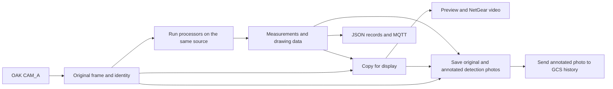

# Computer vision handover

Start here, Aidan. The shared camera stream can run your gauge/valve detector,
read each detected gauge and draw the results alongside ArUco. Enable the target
branch with `--targets`; camera-only and ArUco runs keep their existing defaults.

Keep `Camera Stream`, `Target Detection`, `ArUco Detection` and `Gauge Reader`
together. Imports and the default model path use these sibling folders. Create
new Python environments on your machine rather than copying the Mac's folders.

## Read the code in this order

For the live system, start with these files. The tests and diagnostic tools can
wait until you need to check a particular result.

1. [run_local_demo.py](Camera%20Stream/run_local_demo.py) starts the camera sender,
   local broker and video receiver. `_sender_arguments()` shows which settings
   the launcher passes to the camera process.
2. [run_camera_stream.py](Camera%20Stream/run_camera_stream.py) selects the
   processors and outputs. Start at `main()`; option checks and saved settings
   have their own named functions in the same file.
3. [stream_controller.py](Camera%20Stream/stream_controller.py) is the frame loop:
   read, process, draw a copy, display, save and send.
4. [stream_target_detection.py](Camera%20Stream/stream_target_detection.py) joins
   Aidan's predictions to the gauge reader.
   [stream_target_tracking.py](Camera%20Stream/stream_target_tracking.py) matches
   boxes across frames and checks pressure consistency. The ArUco equivalent is
   [stream_aruco.py](Camera%20Stream/stream_aruco.py).
5. [gcs_output.py](Camera%20Stream/gcs_output.py) formats Lachlan's messages;
   [run_gcs_forwarder.py](Camera%20Stream/run_gcs_forwarder.py) sends the selected
   logs. The image forwarder is a separate command described in the GCS guide.

The standalone image readers, ArUco runner and evaluation scripts are retained
for checking measurements without the whole stream. Earlier completed plans now
live with the project's historical plans: [camera setup](../docs/superpowers/plans/2026-10-05-camera-stream-implementation.md)
and [local networking](../docs/superpowers/plans/2026-10-07-local-network-demonstration.md).

## What is connected already

| Part | Current state | Start reading here |
| --- | --- | --- |
| Camera and frame loop | One OAK CAM_A source, shared processing, preview and run records | [run_camera_stream.py](Camera%20Stream/run_camera_stream.py), then [stream_controller.py](Camera%20Stream/stream_controller.py) |
| Processor interface | A common input and result format for each detector | [stream_processing.py](Camera%20Stream/stream_processing.py) |
| ArUco | Detection, calibrated pose, rejection reasons and overlays are connected | [stream_aruco.py](Camera%20Stream/stream_aruco.py), then [ArUco README](ArUco%20Detection/README.md) |
| Targets and gauge values | Aidan's detector supplies this frame's boxes and clean crops; the adapter reads gauges and draws all targets | [stream_target_detection.py](Camera%20Stream/stream_target_detection.py), then [gauge_reader.py](Gauge%20Reader/gauge_reader.py) |
| Live video | NetGear sends annotated frames; an HTTP bridge makes them viewable in a browser | [stream_video.py](Camera%20Stream/stream_video.py), [run_video_receiver.py](Camera%20Stream/run_video_receiver.py) |
| GCS logs and photos | Sampled logs, one photo per ArUco sighting and periodic gauge/valve photos | [gcs_output.py](Camera%20Stream/gcs_output.py), [stream_detection_capture.py](Camera%20Stream/stream_detection_capture.py) |

`prepare_targets()` loads the local weights once and checks their class names
against Aidan's dataset labels. Valve results keep the detector's `closedValve`
or `openValve` class. The gauge reader uses a 0–10 bar calibration by default;
check it against the actual dial before relying on its pressure values.

## How a frame moves through the system



Processors currently run one after another in the same frame loop. Each sees
the original image. The compositor draws their results on a separate image so
annotations never become input to another detector or end up in the saved
original photo.

The camera profiles request 30 FPS. That does not guarantee 30 model results per
second: inference, drawing and output work all take time. The processing budget
is checked after a processor returns; it cannot interrupt a hung model call.
Measure throughput with targets enabled on the intended hardware.

## Follow the target path

1. `run_camera_stream.py --targets` calls `prepare_targets()` before opening the
   camera. It loads `Target Detection/models/50_epoch_best.pt` by an absolute path
   based on the source location. `--target-model` selects another local file.
2. `TargetDetectionProcessor.process()` calls `Predictor.predict_detections()`
   once for each frame. Aidan's predictor converts the boxes into source pixels
   and returns an independent clean crop for every gauge, plus all valve boxes.
3. The adapter calls `read_gauge()` on each supplied gauge crop. It keeps every
   detection, including gauges that could not produce an accepted pressure.
4. `draw()` reuses Aidan's `annotate_image()` for boxes and labels, then calls the
   gauge renderer inside each matching region of the display overlay. It uses
   saved results and does not run inference or gauge reading again.
5. Native JSON/MQTT records carry the `targets` results; NetGear carries the
   annotated frame. The local demo forwards `--targets` and `--target-model` to
   its sender, which owns the model.

The stream uses the current frame's detection list, not the single-gauge preview
cache. An empty frame therefore has no target annotations left over from an
earlier frame. ArUco is optional in the direct runner; the synthetic source only
assigns its invented calibration to the selected ArUco processor.

### Input and output rules

| Item | What the adapter should use |
| --- | --- |
| Source image | NumPy BGR image, indexed as `[row, column]` or `[y, x]`; shared input is read-only during processing |
| Image shape | `(height, width, channels)`; metadata `image_size_px` is `(width, height)` |
| Image coordinates | Original source pixels, with `(0, 0)` at the top left, positive x right and positive y down |
| Frame identity | Preserve sequence number, device time, host receipt time and source dimensions from the incoming packet |
| Run identity | The runner adds `run_id`; match `(run_id, sequence_number)` across video, results and photos |
| JSON data | Ordinary dictionaries, lists, strings, finite numbers, booleans and `None`; convert NumPy values and model tensors before returning |
| Drawing data | `annotations` can hold local objects; this field is not included in the JSON record |

The predictor maps its normalized boxes using the source image dimensions.
Keep that conversion with the predictor if model preprocessing changes. Device
and host receipt times are clock values in seconds, not calendar dates.

The `targets` processor's `data` contains `schema_version` and a `results` list.
Each result has `class_name`, `bbox_xyxy_px`, `track_id`, `reading_status`,
`raw_gauge_reading` and `gauge_reading`. The box is
`[left, top, right, bottom]` in source pixels, with right and bottom excluded from
the crop. Valve results have null reading fields. Gauge results retain the
current reader's serialized measurements and rejection reason in
`raw_gauge_reading`. Nonfinite fields become JSON null and are listed in
`metadata.nonfinite_fields`. The published `gauge_reading` withholds pressure until
three consecutive accepted values span at most 0.2 bar.
`reading_status` explains whether the pressure is pending, confirmed or unavailable.
Typed reading objects
and normalized boxes used for drawing stay in local `annotations`.

### How the gauge crop is used

`read_gauge(crop, metadata=...)` accepts one candidate gauge image. The adapter
records `coordinate_frame="crop_pixels"` and `crop_origin_px` in its metadata;
the enclosing processor result retains the source frame identity. Consume
`value_bar` only when `valid` is true. Rejected readings remain in the record and
show `gauge | pressure unavailable` on the display. Candidates still waiting for
agreement show `gauge | pressure awaiting confirmation`.

The reader finds the needle directly in the preprocessed crop:

1. Select a long, connected dark shape near the crop centre.
2. Locate its thick hub to find the needle pivot.
3. Choose the longer end as the pointer and measure its direction.
4. Convert that direction into pressure using the gauge calibration.

This assumes a connected dark needle on a light face, a pointer longer than its
counterweight, and a hub near the crop centre. The scale must be upright for the
default calibration; the reader does not correct camera roll or perspective.

The stream associates gauges by overlapping boxes. A missed detection,
ambiguous match, rejected reading or gap over two seconds resets confirmation.
It never replaces an uncertain current value with an older pressure. Local
`track_id` values help follow a target within one run; they are not physical
asset IDs. These checks suppress isolated spikes, but cannot detect every
consistently wrong needle reading. Confirmation does not alter the reader's
single-image calculation.

The reader's `centre` field now holds the needle pivot; `tip` marks the chosen
pointer direction. Both use input-crop pixels, with internal resizing undone.
The retained `radius` and `dial_quality` fields are `null` and `0.0`: this reader
does not measure a dial circle. `needle_quality` measures directional separation
as `1 - short_side / long_side`; it is not a probability of a correct reading.
The adapter draws the pivot and needle in the matching region of the display
overlay, so their positions follow the source-pixel box.
It uses Aidan's clean crop for reading and the accumulated overlay for drawing.

Review `GaugeCalibration` for the actual dial: its defaults are 0–10 bar, a
clockwise 270-degree sweep, zero at 225 degrees and full scale at 135 degrees.
Angles are measured clockwise from up. These gauge settings are separate from
the camera intrinsics used for ArUco pose.

## Understand acceptance and failure

The frame's `status="complete"` means its processor calls completed without a
branch failure. It does not mean every detected object's measurement was
accepted. Check each object's `valid` and `failure_reason` as well.

ArUco can identify a marker and retain its corners, sequence and timestamps while
withholding `pose`. Missing calibration, an unpermitted ID or excessive pixel
error are examples. An empty `results` list means no decoded markers in that
processed frame. Neither case should be replaced with a made-up distance.

Accepted ArUco translation is in metres in the `camera_optical` frame: x right,
y down and z forward. The z value is forward depth, not the straight-line range
to an off-centre marker. `rotation_vector_rad` is an axis-angle rotation vector,
not yaw, pitch and roll. Reprojection error measures pixel fit; it does not prove
physical distance accuracy.

A processor exception becomes a structured branch failure so the other branches
can still report. A drawing, display or output failure can stop the run. Inspect
the saved records when a stream stops rather than assuming inference failed.

## Connect the model results to Lachlan's side

The live picture and MQTT records take different routes. NetGear carries video
to the receiver. The browser reads the receiver's HTTP stream. MQTT carries
measurements and GCS messages; using the same port alone does not connect these
routes.

Native frame records and generic MQTT messages include the `targets` branch,
and NetGear video includes its annotations. The separate GCS log forwarder maps
a sampled frame to the existing ArUco message plus one message per gauge or valve.
The outer payload stays `{action, content}`. Gauge text reports accepted pressure
or `Pressure unavailable`; valve text reports `Open valve` or `Closed valve`,
with image centre and frame number. A failed target branch produces a processing
error log.

By default the forwarder selects one frame every five seconds and sends all its
messages, so one sample can produce several small logs. Restart the camera and
forwarders after updating the code. Preview
prints the payloads without contacting the GCS; publication explicitly selects
`127.0.0.1:1883` when the forwarder and GCS run on the Pi, topic
`gcs/drone_log`. A forwarder on the Mac uses the Pi's LAN address
`10.88.39.170` instead. Local audit lines retain source run/frame
identity and each message's delivery outcome. GCS/MySQL ingestion still needs
confirmation on the receiving side.

Automatic photos cover gauges and valves every three seconds while targets are
visible, plus the existing once-per-sighting ArUco policy. A selected source
frame produces one capture event, with all current targets in its caption and sidecar.
Use `--capture-detections --capture-interval-s 3` on the camera launcher and
`--interval-s 3` on the image forwarder. The upload byte budget can delay delivery;
the bounded pending queue skips further photos when full. All processed-frame
results remain in the native JSONL log.

Automatic captures save a full-resolution original PNG and the matching annotated
PNG already composed for the live feed. Both count toward the storage limit.
The event file is written last so the uploader knows both images are ready.
Only the annotated image is uploaded; the original stays available locally.
Older captures without an annotated image still upload their original.
The GCS image payload uses `type`, `description`, `mime`, Base64 `image`
and `timestamp`. Thumbnail sizing belongs in the dashboard display.

The photo forwarder watches one fixed `--capture-dir`. Every new camera run has
a new directory, so point the forwarder at the path printed for that run. Use
`--timeout-s 0` to keep it running until Ctrl+C. A broker acknowledgement confirms
the broker accepted the message; it does not confirm database storage or gallery
display. See the [GCS integration guide](Camera%20Stream/docs/gcs-integration.md)
for exact commands, queue states and retry handling.

## Run and check the handover

Use Python 3.12 for the existing pinned environment. From `Computer Vision`:

```sh
cd "Camera Stream"
python3.12 -m venv .venv
.venv/bin/python -m pip install -r requirements-network.txt
```

Start with the software-only local demo. This needs no camera or teammate's
broker and uses an invented scene and calibration:

```sh
.venv/bin/python -B run_local_demo.py --max-frames 60 --open-browser
```

For target detection, create the separate environment from `Camera Stream`:

```sh
.venv/bin/python -m venv .venv-targets
.venv-targets/bin/python -m pip install -r requirements-targets.txt
```

Keep the local weights at `Target Detection/models/50_epoch_best.pt` and the class
list at `Target Detection/data/v2_EGH455-3/data.yaml`. From `Camera Stream`, start a
direct camera preview:

```sh
.venv-targets/bin/python -B run_camera_stream.py \
  --targets --profile 720p30 --max-frames 300
```

For the camera, local MQTT results and browser video together:

```sh
.venv-targets/bin/python -B run_local_demo.py \
  --camera --targets --profile 720p30 --max-frames 300 --open-browser
```

Change `--max-frames` for a shorter or longer trial; it counts processed frames,
not seconds. Both commands accept `--target-model "/path/to/weights.pt"` when
`--targets` is enabled. Explicit model paths are resolved from the caller's
working directory. The default path is independent of that directory.

The direct command can also take `--aruco`; the local demo
already enables ArUco. Calibration and marker-size options are optional for
viewing detections, but calibrated metric ArUco pose needs the correct settings.
The [stream README](Camera%20Stream/README.md) explains those options, and the
[local network walkthrough](Camera%20Stream/docs/local-network-walkthrough.md)
covers same-network viewing. The local browser endpoint is
`http://127.0.0.1:8080/stream.mjpeg`. Only one process can own the OAK camera at a time.

The saved OAK calibration belongs to the camera identified in that JSON file.
Use calibration for the actual camera and stream geometry. The assignment marker
is 200 mm; our monitor test used a measured square of approximately 150 mm.
Use the physical outer black-square size, not the generator's requested size.

Run the current camera-free checks from their own folders:

```sh
# From Computer Vision/Camera Stream
.venv/bin/python -B -m unittest discover -s tests

cd "../ArUco Detection"
PYTHONPATH="../Camera Stream" "../Camera Stream/.venv/bin/python" -B -m unittest discover -s tests

cd "../Gauge Reader"
"../Camera Stream/.venv/bin/python" -B -m unittest discover -s tests
```

The adapter checks use controlled predictions, generated images and the real
gauge reader/renderers, so they can run in the existing camera `.venv` without
model weights. They cover empty frames, multiple targets and preservation of the
original pixels. The actual weights have also been checked on local saved images
and through a synthetic network run. Detection quality and target throughput on
the OAK camera stream still need their own trial; the software checks do not
establish either.

## Where to look when something is wrong

The local demo prints a new directory under
`Camera Stream/diagnostics/local-network/`. Its `sender/frames.jsonl` contains
one JSON record per processed frame, including identity and branch results.
`processors` is a list. Select the entry whose `processor` is `"aruco"` or
`"targets"`, then read `entry["data"]["results"]`. `run.json` records the selected
model path, SHA-256, class names and gauge settings under `metadata.targets`.
Standalone ArUco commands have a different outer record; their evaluation tool
should not be given shared-stream records unchanged.

When `--capture-detections` is enabled, the demo's `sender/detections/` holds
original images, detection events and uploader receipts. `pending=0, failed=3`
means that folder has three failed events and nothing waiting to send.
It does not mean new images are arriving. Check the
directory, event reasons and the separate photo forwarder's destination first.

For a guided explanation, use the [stream walkthrough](Camera%20Stream/docs/stream-walkthrough.md).
The [hardware benchmark](../Hardware%20Diagnostics/OAK-D-Lite/README.md) is a
separate evidence tool for USB/camera trials, not the application entry point.
Its archived measurements should remain unchanged during model integration.
